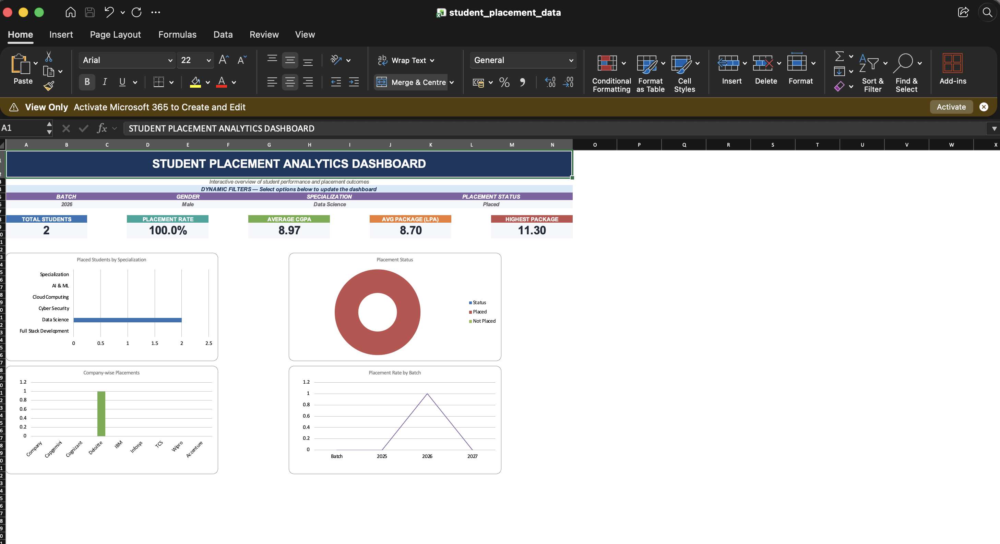

# 📊 Student Placement Analytics Dashboard

An interactive **Student Placement Analytics Dashboard** built using **Google Sheets and Microsoft Excel** to analyze student academic performance and placement outcomes.

The project transforms raw student placement data into an easy-to-understand dashboard with **dynamic filters, KPI cards, and multiple data visualizations**.

## 🎯 Project Objective

The objective of this project is to provide a simple and interactive way to analyze student placement performance and identify trends related to specialization, companies, academic performance, and placement outcomes.

## ✨ Key Features

- 📌 **250 Student Records**
- 🎛️ **Dynamic Filters**
  - Batch
  - Gender
  - Specialization
  - Placement Status
- 📊 Interactive placement visualizations
- 🎓 Specialization-wise placement analysis
- 🏢 Company-wise placement analysis
- 📈 Batch-wise placement rate analysis
- 🟢 Placed vs Not Placed comparison
- 📋 KPI-based performance summary

## 📌 Dashboard KPIs

| KPI | Value |
|---|---:|
| Total Students | 250 |
| Placement Rate | 59.2% |
| Average CGPA | 7.76 |
| Average Package | 5.91 LPA |
| Highest Package | 11.70 LPA |

## 📊 Dashboard Visualizations

The dashboard includes:

- **Placed Students by Specialization** — compares placement performance across AI & ML, Cloud Computing, Cyber Security, Data Science, and Full Stack Development.
- **Placement Status** — shows the proportion of placed and non-placed students.
- **Company-wise Placements** — analyzes the number of students recruited by different companies.
- **Placement Rate by Batch** — displays placement performance across different student batches.

## 🛠️ Tools & Technologies

- **Google Sheets** — Dynamic dashboard and interactive analysis
- **Microsoft Excel** — Dataset creation and spreadsheet management
- **Google Apps Script** — Dashboard generation and automation
- **GitHub** — Project documentation and version control

## 📂 Dataset

The dataset contains 250 student records with attributes including:

`Student ID` • `Student Name` • `Gender` • `Batch` • `Specialization` • `CGPA` • `Attendance` • `Internships` • `Projects` • `Technical Score` • `Aptitude Score` • `Communication Score` • `Primary Skill` • `Placement Status` • `Company` • `Package`

## 🖼️ Dashboard Preview

## 🚀 How to Use

1. Download the project spreadsheet from this repository.
2. Open the dataset/dashboard in a compatible spreadsheet application.
3. Explore the dashboard KPIs and visualizations.
4. Use the available filters to analyze different student groups.
5. Compare placement trends across batches, specializations, and placement status.

## 💡 Applications

This dashboard can help educational institutions and placement teams:

- Monitor overall placement performance.
- Compare placement outcomes across specializations.
- Analyze company recruitment patterns.
- Evaluate student academic and placement trends.
- Support data-driven placement planning and decision-making.

## 👨‍💻 Author

**Sparsh Singhania**

Student Placement Analytics Dashboard  
Data Analytics & Visualization Project

---

⭐ If you found this project useful, consider giving the repository a star!
